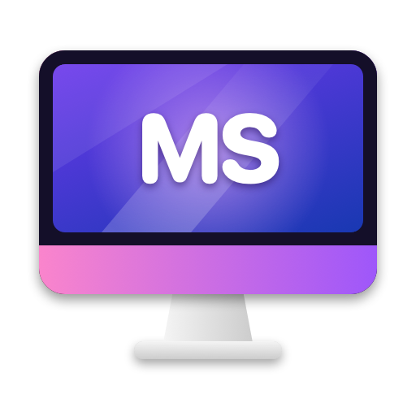
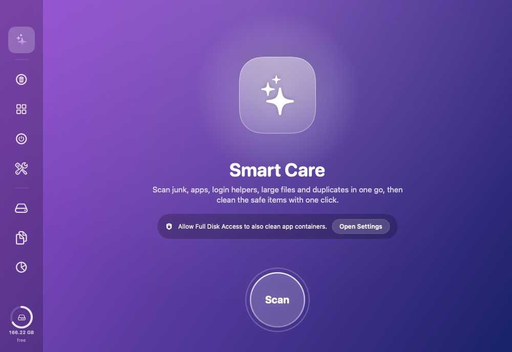
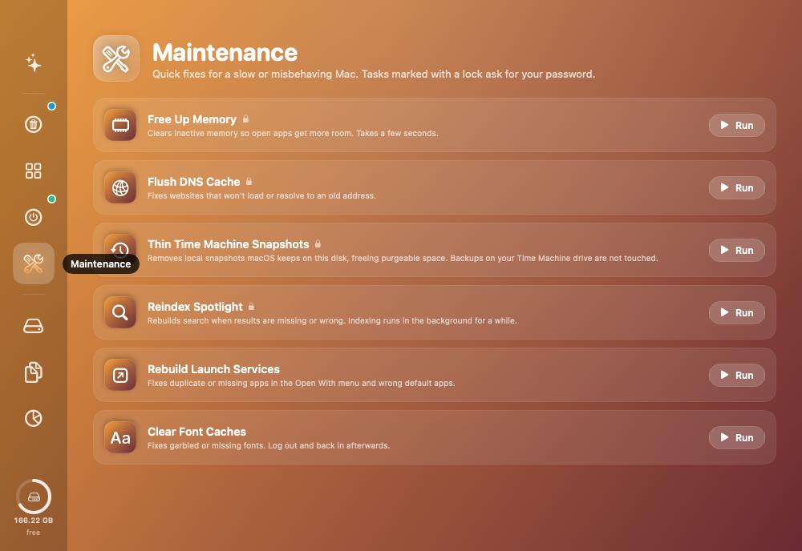

<p align="center"></p>

# MacSweep

A native macOS cleaner and health monitor written in SwiftUI. It finds junk, leftovers and clutter, and shows exactly what each item is. It only ever moves things to the Trash, so every clean can be undone.

<p align="center"></p>

## Features

- **Smart Care**: scans everything at once and cleans only the items that are safe by default.
- **System Junk**: app caches, Electron/Chromium caches, logs, Gradle caches, broken preference files, and Xcode data (DerivedData, documentation cache, device logs, device support, archives, unavailable simulators).
  - Caches belonging to apps that are open are held back.
  - Apple system caches are listed but never preselected.
- **Uninstaller**: removes an app with its support files, caches, preferences, containers, group containers (only when no other app shares them), launch agents and daemons, and audio plug-ins. It also finds files left behind by apps you already deleted.
- **Launch Agents**: lists login helpers and flags broken ones whose program no longer exists.
- **Large Files** and **Duplicates**:
  - Large Files lists files of 500 MB or more.
  - Duplicates finds identical files by SHA-256. It keeps the oldest copy, skips APFS clones and ignores code folders such as `node_modules`.
- **Space Map**: browse any folder by size and drill down.
- **Maintenance**: free up memory, flush DNS, thin Time Machine local snapshots, reindex Spotlight, rebuild Launch Services, clear font caches. Admin tasks use the standard macOS password prompt.
- **Mac Health menu bar panel**: disk, memory pressure, CPU load and heat level, battery, network throughput, and connected Bluetooth devices.
- **Export Report**: writes a Markdown list of everything found, handy for a second opinion before cleaning.

<p align="center"></p>

## Requirements

- macOS 14 or later
- Xcode command line tools (Swift 5.10+)

## Build

```bash
./make-app.sh
open MacSweep.app
```

`make-app.sh` builds a release binary, generates the app icon, and packages an ad-hoc signed `MacSweep.app`.

For the most complete scan, give MacSweep **Full Disk Access** in System Settings › Privacy & Security. Without it, other apps' sandbox containers are skipped.

## Command-line options

```bash
MacSweep.app/Contents/MacOS/MacSweep --scan-report        # summary of every scan
MacSweep.app/Contents/MacOS/MacSweep --report out.md      # full Markdown report
MacSweep.app/Contents/MacOS/MacSweep --self-test          # plants test files, scans, cleans, verifies
open -n MacSweep.app --args -tour /tmp/macsweep-tour       # UI walkthrough with screenshots and a PASS/FAIL log
```

The self-test and the tour only create and remove their own test files.

## Safety

- Nothing is deleted permanently. Cleaning moves items to the Trash.
- Risky items are never selected for you: large files, duplicates, apps, archives, device support files, and working launch agents.
- System files that need admin rights are reported instead of forced.

## Disclaimer

MacSweep is an independent project. It is not affiliated with or endorsed by Apple or any other cleaner vendor.
